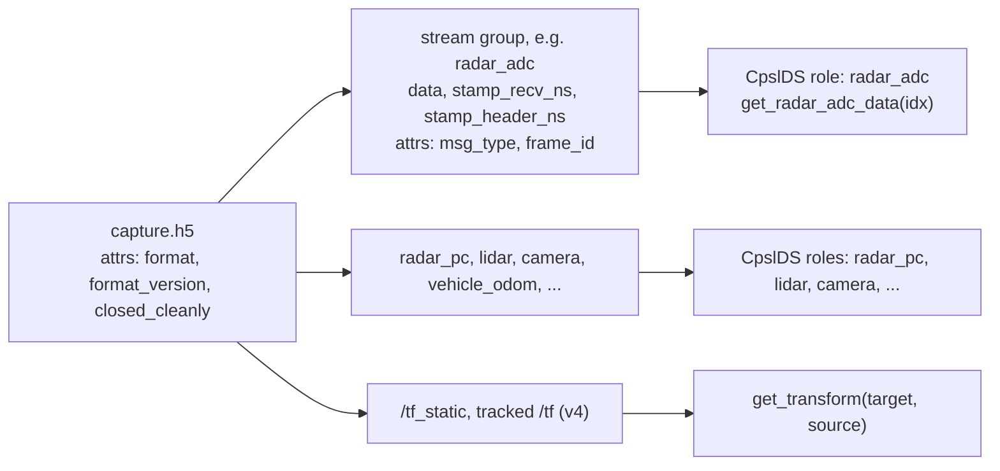
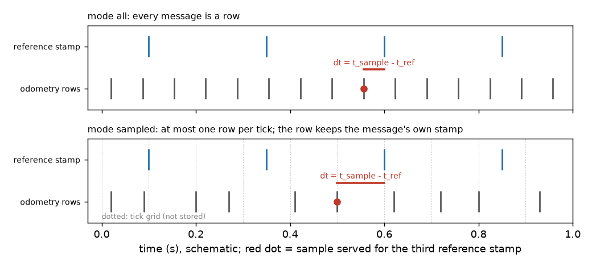

# CPSL Datasets user guide

Three pages: this one, [streams.md](streams.md) (every non-radar stream; its
[appendix](streams.md#appendix-every-role-getter-and-return) lists every role with getter,
shape and stamp rule) and [radar.md](radar.md). Snippets run as written once `capture.h5` is your
file; the `# synth:` comment names the synthetic capture they are tested against. Stream names
are those of a console capture; your file's are in `ds.roles` or `inspect`. Use `uv run` for
everything (see the [README](../README.md), which also shows how to
[build the API reference](../README.md#api-reference)).

## First five minutes

```bash
uv run python -m cpsl_datasets.inspect capture.h5 --validate
```

```python
# synth: all
from cpsl_datasets import CpslDS

with CpslDS("capture.h5") as ds:      # several streams of one type? name one: radar_adc="..."
    print(ds)                         # file, frames, bound roles
    cube = ds.get_radar_adc_data(0)   # complex64, raw ADC counts (no scaling)
    m = ds.match("vehicle_odom", 0)   # which odometry sample frame 0 got, and its dt
    odom = ds.get_vehicle_odom_data(0)
    print(cube.shape, m.dt_ns / 1e6, odom.shape)
```

Example files: v1 conversions are in `~/Documents/cpsl_datasets_data/v1_converted/`; captures
made with the console are in the console repo's `data/datasets/`.

**Roles.** A *role* is the reader's fixed name for a kind of data; each getter reads one role
(`get_radar_adc_data` reads `radar_adc`, `get_vehicle_odom_data` reads `vehicle_odom`,
`get_chirp_meta` reads `chirp_meta`). A *stream* is whatever the recorder named it in the file.
`ds.roles` maps role to stream, filled automatically by message type; override it with a
keyword such as `radar_pc="radar_1_pc"`. One stream can fill two roles. On a rover capture:

```
ds.roles     = {'radar_adc': 'radar_adc', 'vehicle_odom': 'odometry',
                'chirp_meta': 'adc_meta', 'vehicle_vel': 'odometry'}
len(ds) = 101, ds.reference = 'radar_adc'
```

`ds.reference` is the role whose samples define the **frames**: `len(ds)` and `idx` count its
samples (here, 101 radar cubes) and every other role is matched to frame `idx`. Choose it with
`reference=`.

## What a dataset is

One `.h5` file in the `cpsl_dataset_hdf5` format, written by the Sensors repo's
`dataset_recorder` (or converted from an old folder of `.npy` files, see the README). Each
recorded ROS topic is a **stream**: an HDF5 group holding the samples (`data`), two time stamps
per sample (`stamp_recv_ns`, `stamp_header_ns`) and attributes (`msg_type`, `frame_id`, ...).
Point clouds are stored ragged. Format version 4 files also carry `/tf_static` and tracked `/tf`.



*Figure 1. File layout and how `CpslDS` exposes it. The format is defined in the Sensors repo:
[hdf5_format.md and reading_datasets.md](https://github.com/cpsl-research/CPSL_ROS2_Sensors/tree/main/src/dataset_generator/docs).*

## Look before you open

The `inspect` command above prints the format, version and `closed_cleanly`, a table of streams
(name, type, samples, frame id, time span), a recv-versus-header clock report, and the static
and tracked transforms. `--validate` adds structural checks and prints `validate: no problems`
when the file is sound. "header stamps are -1 (no header): use recv" means the file has no
usable header stamps (every converted v1 file, see [radar.md](radar.md)).

## Open it

The default reference is the first non-empty of radar_adc, radar_pc, lidar, camera; every other
getter returns that role's newest sample at or before the reference sample's stamp.

```python
# synth: v4
from cpsl_datasets import CpslDS

with CpslDS("capture.h5") as ds:
    print(ds)                          # file, frames, bound roles
    print(len(ds), ds.reference)       # number of frames, reference role
    print(ds.roles)                    # role -> stream name actually bound
    print(list(ds.capture.streams()))  # every stream in the file
    cube = ds.get_radar_adc_data(0)    # complex64, (rx, sample, chirp)
    print(cube.shape, cube.dtype)
```

If several streams match one role, construction raises `ValueError` naming the matches
(`radar_pc: 3 streams match`). Name the stream, or switch the role off with `False`. Files with
several radars (the converted vicon and IcaRAus v1 files) always need this, so plain
`CpslDS(path)` fails on them; take the names from `inspect`:

```python
# synth: multi
from cpsl_datasets import CpslDS

ds = CpslDS("capture.h5", radar_pc="radar_front_pc")   # a stream name from inspect
print(ds.roles)
```

A role with no stream in the file makes its getter raise `ValueError` ("no <role> stream").
`sync=False` turns off alignment: `idx` is then the role's own sample index, and
`IndexError` is raised past the end.

```python
# synth: v4
from cpsl_datasets import CpslDS

ds = CpslDS("capture.h5", sync=False)
print(ds.get_vehicle_odom_data(2).shape)   # sample 2 of the odometry stream itself
```

Early frames can be empty: a stream whose first sample arrived after the reference stamp
returns an empty array (`(0, 4)`, `(0, 0)`, `nan` for yaw). Test the size before indexing. **Getters read from the HDF5 file on every call**, so `np.stack` over every frame
loads the whole stream into memory; loop and reduce, or slice the stream itself.

**Choosing the reference.** To align to something other than the default, say so:

```python
# synth: all
from cpsl_datasets import CpslDS

ds = CpslDS("capture.h5", reference="vehicle_odom", match="nearest", clock="header",
            tf_message=False)
print(len(ds), ds.reference)        # frames are now odometry samples
```

- `reference="lidar"` (any bound role): which role counts the frames.
- `match="previous"` (default) serves the newest sample at or before the reference stamp;
  `"nearest"` the closest either side (ties go to the earlier). Windowed streams are unchanged.
- `clock="recv"` (default) aligns on the recording host's receive stamp; `"header"` uses the
  message stamp and raises if any bound stream has none (add `tf_message=False`). Native console
  captures only: converted v1 files have no header stamps (-1) and raise. The two
  differ by about 100 ms on `radar06` and about 3 ms on a rover capture ([radar.md](radar.md)).

## Capture modes

The recorder runs in one of two modes, stored as the root attribute `capture_mode`. In `all`
every message is a row at its own rate. In `sampled` the recorder emits at most one row per tick
at `sample_rate_hz` (the newest message since the last row), and the row keeps **that message's
own recv stamp, not the tick time**: no tick stamp is stored, and a tick with no new message
writes no row. A single stream may override the mode.



*Figure 2. The sample a getter serves (red dot) and `dt = t_sample - t_ref` for the third
reference stamp. In `sampled`, dt can reach a tick period.*

`inspect` prints `capture_mode`, `sample_rate_hz` and each stream's `mode`; for `sampled`
streams it adds `fill`, rows divided by ticks in the span (1.00 = a row every tick, `n/a`
without a rate). In Python: `ds.capture.capture_mode`, `ds.capture.sample_rate_hz` (`None` if
absent) and `ds.streams[name].mode`.

## Which sample, and how far off

`ds.match(role, idx)` returns `Match(j, t_ns, dt_ns)`: the raw sample index served, its stamp
(int ns, chosen clock) and `dt = t_sample - t_ref`, negative when the sample is older than the
reference. `ds.row_stamps(role, idx)` gives the stamp of each row a getter returned. To query by
time instead of frame:

| Call | Returns |
|---|---|
| `at_time(role, t_ns, method="previous", tol_ns=None)` | `Match` at that time; `Match(-1, None, None)` if none |
| `window(role, t0_ns, t1_ns)` | raw indices with `t0 < stamp <= t1` |
| `read(role, j)` | what the role's getter returns for raw sample `j` |
| `interp(role, t_ns, max_gap_ns=None)` | odometry, vel, IMU, Vector3, Vicon, linearly (quaternion: slerp) |

**The -1 trap.** `j = -1` means "no sample yet". Indexing with it would silently return the last
sample, so `read(role, -1)` raises `IndexError`: check `Match.j` first. `interp` returns **NaN**
(never a clamped value) before the first or after the last sample, and across a gap wider than
`max_gap_ns` (default 3 times the stream's median period).

```python
# synth: all
from cpsl_datasets import CpslDS
import numpy as np

ds = CpslDS("capture.h5")
m = ds.match("chirp_meta", 2)
if m.j >= 0:
    meta = ds.read("chirp_meta", m.j)           # the meta served for frame 2
    print(m.j, m.dt_ns / 1e6, "ms")
t = ds.get_stamps("radar_adc")                  # int64 ns
pose = ds.interp("vehicle_odom", t)             # (n, 13); NaN where there is no data
print(np.isnan(pose).any(axis=1).sum(), "frames without a pose")
print(ds.window("vehicle_odom", t[0], t[1]))    # odometry samples between two frames
```

