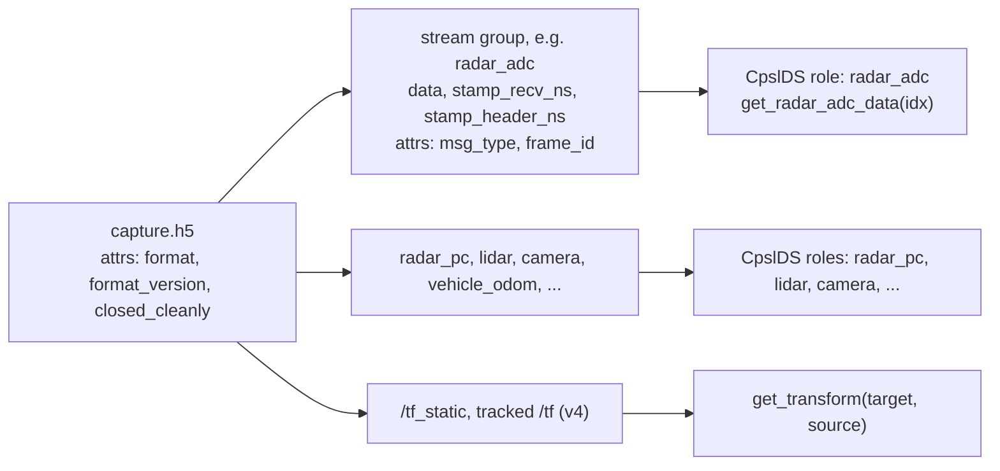

# CPSL Datasets user guide

Start here. Three pages: this one (what a dataset is, how to open one), [streams.md](streams.md)
(every non-radar stream) and [radar.md](radar.md) (the radar, in depth). Snippets are short and
run as written once `capture.h5` is your file; the `# synth:` comment on the first line names the
synthetic test capture they are checked against. Use `uv run` for everything (see the
[README](../README.md)).

## What a dataset is

One `.h5` file in the `cpsl_dataset_hdf5` format, written by the Sensors repo's
`dataset_recorder` (or converted from an old folder of `.npy` files, see the README). Each
recorded ROS topic is a **stream**: an HDF5 group holding the samples (`data`), two time stamps
per sample (`stamp_recv_ns`, `stamp_header_ns`) and attributes (`msg_type`, `frame_id`, ...).
Point clouds are stored ragged (a `row_count` per sample). Format version 4 files also carry
`/tf_static` and the tracked `/tf` edges.



*Figure 1. File layout and how `CpslDS` exposes it. The format itself is defined in the Sensors
repo, which this guide links and does not copy:
[hdf5_format.md and reading_datasets.md](https://github.com/cpsl-research/CPSL_ROS2_Sensors/tree/main/src/dataset_generator/docs).*

## Look before you open

```bash
uv run python -m cpsl_datasets.inspect capture.h5 --validate
```

This prints the file, format, version and whether it was `closed_cleanly`, a table of streams
(name, message type, sample count, frame id, time span), a recv-versus-header clock report,
the static transforms and the tracked tf pairs. `--validate` adds structural checks and prints
`validate: no problems` when the file is sound. If it says "header stamps are -1 (no header):
use recv", the file has no usable header stamps (every converted v1 file, see
[radar.md](radar.md)).

## Open it

`CpslDS` binds each **role** (radar_adc, radar_pc, lidar, camera, ...) to a stream by message
type. Frame `idx` counts samples of the **reference stream**, the first non-empty of
radar_adc, radar_pc, lidar, camera (or `reference="lidar"`); every other getter returns that
stream's newest sample whose stamp is at or before the reference sample's stamp.

```python
# synth: v4
from cpsl_datasets import CpslDS

with CpslDS("capture.h5", radar_adc="radar_adc", vehicle_vel="twist_st") as ds:
    print(ds)                          # file, frames, bound roles
    print(len(ds), ds.reference)       # number of frames, reference role
    print(ds.roles)                    # role -> stream name actually bound
    print(list(ds.capture.streams()))  # every stream in the file
    cube = ds.get_radar_adc_data(0)    # complex64, (rx, sample, chirp)
    print(cube.shape, cube.dtype)
```

If several streams match one role, construction raises `ValueError` naming the matches
(`radar_adc: 2 streams match`). Name the stream, or switch the role off with `False`. The same
file above would not open as plain `CpslDS("capture.h5")` because it has two cube streams and
two velocity streams. A capture with several radars needs the same treatment:

```python
# synth: multi
from cpsl_datasets import CpslDS

ds = CpslDS("capture.h5", radar_pc="radar_pc_0", lidar=False)
print(ds.roles)
```

A role with no stream in the file makes its getter raise `ValueError` ("no <role> stream").
`sync=False` turns off alignment: `idx` is then the role's own sample index, and
`IndexError` is raised past the end.

```python
# synth: v4
from cpsl_datasets import CpslDS

ds = CpslDS("capture.h5", radar_adc="radar_adc", vehicle_vel="twist_st", sync=False)
print(ds.get_vehicle_odom_data(2).shape)   # sample 2 of the odometry stream itself
```

Two things to expect on real files:

- **Early frames can be empty.** If a stream's first sample arrived after the reference
  stamp, its getter returns an empty array (`(0, 4)`, `(0, 0)`, `nan` for yaw). Test the size
  before indexing.
- **Clock.** `clock="recv"` (default) aligns on the recording host's receive stamp, shared by
  every stream. `clock="header"` uses the message stamp and raises if any bound stream has none.
  The two differ by about 100 ms on a real radar; see [radar.md](radar.md).

## Which page next

| You want | Read |
|---|---|
| lidar, camera, depth, odometry, IMU, Vicon, hands, Leap images, tf | [streams.md](streams.md) |
| ADC cube, point cloud, radar config, chirp metadata, timing | [radar.md](radar.md) |
| every role with getter, return shape and stamp rule | [streams.md, appendix](streams.md#appendix-every-role-getter-and-return) |
| the full `CpslDS` constructor | `help(CpslDS)` |
