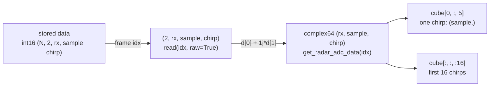
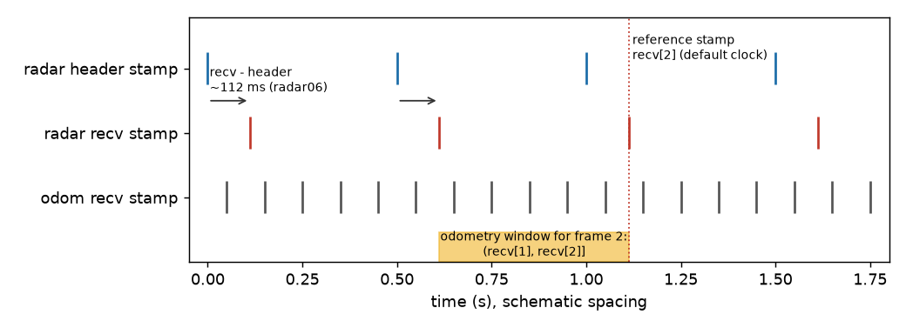

# Radar data

> **cpsl_datasets returns raw radar data and does not process it.** It gives you the ADC
> cube, the recorded radar config, the chirp metadata and the recorded point cloud, exactly as
> stored. No range FFT, Doppler, CFAR, calibration or beamforming. Signal processing lives in
> [CPSL_TI_Radar](https://github.com/davidmhunt/CPSL_TI_Radar) (which includes `radar_gui`).

Open a file as in [index.md](index.md). Real-file numbers below come from one sensor (`radar06`); nothing here has been
measured on another.

## ADC cube

Stored: an `ADCDataCube` stream. `data` is `int16`, `(N, 2, rx, sample, chirp)`; the `2` is
real and imaginary. `get_radar_adc_data(idx)` returns `complex64` `(rx, sample, chirp)`, i.e.
`d[0] + 1j * d[1]`. The values are the raw `int16` ADC counts held in a `complex64`: no scaling, no
volts, no windowing. Cube sizes differ per file (`radar06`: `(1, 3300, 255)`; converted files: `(4, 70, 120)`, `(4, 63, 300)`).
Read the group's `axes` attribute to see the stored axis order instead of assuming it.



*Figure 3. Cube axes and slicing.*

```python
# synth: v4
from cpsl_datasets import CpslDS
import numpy as np
import matplotlib.pyplot as plt

ds = CpslDS("capture.h5")
cube = ds.get_radar_adc_data(0)                          # (rx, sample, chirp) complex64
raw = ds.streams["radar_adc"].read(0, raw=True)          # (2, rx, sample, chirp) int16
assert np.allclose(raw[0] + 1j * raw[1], cube)
chirp = cube[0, :, 0]                                    # one chirp, receiver 0
plt.plot(chirp.real, label="real")
plt.plot(chirp.imag, label="imag")
plt.legend()
plt.show()
```

## Radar config and chirp parameters

`get_radar_cfg()` returns the config the radar ran with (v3 and later), or `None` if there is
none: v2 files, converted v1 files, or a recorded status other than `"ok"`. It is a dict with
keys `changed, metrics, path, sha256, status, text, topic`; `text` is the `.cfg` text and
`metrics` the decoded chirp numbers (`n_rx`, `num_samples`, `n_chirps`, `range_res_m`,
`frame_rate_hz`, `bandwidth_mhz`, ...; full list in the appendix).

```python
# synth: v4
from cpsl_datasets import CpslDS

ds = CpslDS("capture.h5")
cfg = ds.get_radar_cfg()
if cfg is not None:
    m = cfg["metrics"]
    print(m["range_res_m"], m["frame_rate_hz"])
    cube = ds.get_radar_adc_data(0)
    print((m["n_rx"], m["num_samples"], m["n_chirps"]) == cube.shape)   # cube matches cfg
```

## Chirp metadata

Newer recorders store an `adc_meta` stream (`ADCChirpMeta`) beside the cube, one sample per
cube. `get_chirp_meta(idx)` returns a dict of the stored arrays: per-chirp arrays of length
`n_chirps` (`record_valid`, `adc_complete`, `has_time`, `time_interpolated`, `flags`, `run_idx`,
`global_chirp_idx`, `ts_ticks`, `sat_slices`, `sat_ref_lag`, `sat_slices_aligned`, `t_s`),
per-frame scalars (`frame_index`, `run_known`, `run_idx_frame`, `records_valid`,
`records_invalid`, `records_other_run`) and `prev_tail_sat`. `t_s` is the radar's own clock in
seconds, not epoch time. `{}` when there is none yet.

```python
# synth: v4
from cpsl_datasets import CpslDS

ds = CpslDS("capture.h5")
meta = ds.get_chirp_meta(0)
print(meta["record_valid"].all(), meta["t_s"][:3])
```

## Point cloud

Stored: a ragged `PointCloud2` stream with a `vel` column. `get_radar_point_cloud(idx)` returns
`(n, 4)` x y z vel (metres, m/s), `float32` on real files; empty `(0, K)` when there are no
detections. Points are in the sensor frame (`frame_id`) unless you open the file with
`frame="base_link"`, which maps x y z through `/tf_static` (v4 files only). With several
radars, name one: `radar_pc="radar_combined_pc"`.

```python
# synth: v4
from cpsl_datasets import CpslDS
import matplotlib.pyplot as plt

ds = CpslDS("capture.h5")
pc = ds.get_radar_point_cloud(0)
if len(pc):
    plt.scatter(pc[:, 0], pc[:, 1], c=pc[:, 3])
    plt.colorbar(label="vel (m/s)")
    plt.show()
```

## Timing and syncing

Every sample has two stamps. `stamp_recv_ns` is the recording host's clock when the message
arrived; it is shared by all streams. `stamp_header_ns` is the stamp inside the message, set by
the driver; `-1` means none. **The default clock is recv**, so all streams align on one clock.

On `radar06` the radar's recv stamp is later than its header stamp by a large, jittery amount
(`recv - header`, from `inspect.clock_report` on the file's `radar_adc` stream):

| Stream (`radar06`, 66 frames) | mean | std | min | max |
|---|---|---|---|---|
| `radar_adc` | 112.1 ms | 4.9 ms | 104.8 ms | 126.3 ms |
| `adc_meta` | 104.4 ms | 1.5 ms | 102.7 ms | 108.4 ms |

With `clock="header"` radar frames line up ~100 ms earlier against recv-stamped streams.

```python
# synth: v4
from cpsl_datasets import CpslDS
from cpsl_datasets.inspect import clock_report

ds = CpslDS("capture.h5")
print(clock_report(ds.capture.streams()[ds.roles["radar_adc"]]))   # n, n_unstamped, mean_ms, std_ms, ...
print(ds.get_stamps("radar_adc")[:3])                      # int64 ns, chosen clock
```



*Figure 4. Schematic: header and recv stamps of a radar, an odometry stream on recv stamps,
the reference stamp and the odometry window. Spacing is illustrative; the ~112 ms offset is
`radar06`.*

**Frame-synced getters.** Frame `idx` is the idx-th radar cube. Cube, point cloud, camera and
lidar getters return the newest sample at or before that cube's stamp (ties go to the later
row); odometry, velocity, IMU, Vector3 and Vicon return the window
`(t_ref[idx-1], t_ref[idx]]`. Switch the clock, matching and reference as in
[index.md](index.md#open-it).

**Worked example: a rover capture (`all`).** One rover recording holds `radar_adc` (101 cubes,
4 Hz), `adc_meta`, `odometry` (15 Hz) and the tracked `odom` to `base_link` edge. On the
default recv clock `adc_meta` arrives about 3 ms *after* its cube, so it is not yet "at or
before" the cube's stamp: for 62 of the 101 frames `ds.match("chirp_meta", i)` serves the
**previous** frame's meta (`dt` about -251 ms, one cube period). `clock="header"` fixes it: the
two share a header stamp and `dt` is 0 for every frame. Odometry `dt` was -68 to -3 ms on recv. `interp` of odometry at the radar stamps gives a pose for 100 of 101 frames; the last
cube is stamped after the final odometry row, so it is NaN.

```python
# synth: all
from cpsl_datasets import CpslDS
import numpy as np

for clock in ("recv", "header"):
    ds = CpslDS("capture.h5", clock=clock, tf_message=False)
    dts = [ds.match("chirp_meta", i).dt_ns for i in range(len(ds))]
    stale = sum(d < -1e8 for d in dts if d is not None)
    pose = ds.interp("vehicle_odom", ds.get_stamps("radar_adc"))
    print(clock, "meta from the previous frame:", stale, "of", len(ds),
          "| frames with no pose:", int(np.isnan(pose).any(axis=1).sum()))
```

**Deprecated.** `get_radar_data(idx)` is the v1 getter (point cloud if one is bound, else the
cube) and warns; use `get_radar_adc_data` or `get_radar_point_cloud`. Outside the notebook,
name streams as keyword arguments (`radar_pc="radar_pc_1"`). `CPSL_STREAMS` (a JSON role to
stream map) is read only by `notebooks/dataset_viewer.ipynb`; in your own script use
`CpslDS(path, **json.loads(os.getenv("CPSL_STREAMS", "{}")))`.

## Appendix: radar `metrics` keys

`adc_start_us, azimuth_res_deg, bandwidth_mhz, bytes_per_chirp, bytes_per_frame,
bytes_per_sample, calculator, calculator_version, center_ghz, chirp_us, chirps_per_loop,
doppler_bins, doppler_step_ms, frame_period_ms, frame_rate_hz, idle_us, lambda_mm,
loop_period_us, lvds_data_fmt, max_range_ideal_m, max_range_m, max_velocity_ms, n_az_virtual,
n_chirps, n_loops, n_rx, n_tx, n_virtual, num_frames, num_samples, ramp_us, range_res_m,
sample_rate_ksps, sampling_us, scheme, slope_mhz_us, start_ghz, velocity_res_ms`. Listed from
`radar06`; the synthetic test file has only a few. The `get_radar_cfg()["text"]` is the
authoritative `.cfg`.
